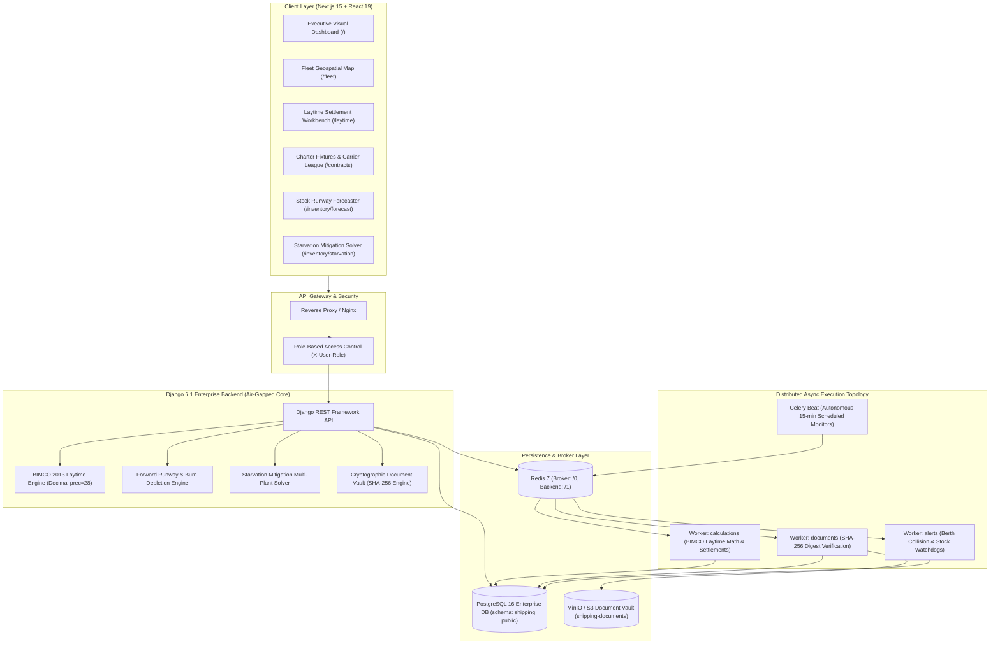

# Enterprise Overseas Bulk Vessel Chartering & Logistics Management Dashboard
### Built for Steel Authority of India Limited (SAIL) & Ministry of Steel (SIH26006)

[](file:///scripts/verify_system.py)
[](file:///backend/)
[](file:///backend/config/settings.py)
[](file:///backend/config/settings.py)
[-black?style=for-the-badge&logo=next.js)](file:///frontend/)
[](file:///docker-compose.yml)

---

## 1. Executive Summary & Problem Statement

The **Enterprise Overseas Bulk Vessel Chartering & Logistics Management Dashboard** is an industrial-grade, mission-critical decision intelligence platform purpose-built for the **Steel Authority of India Limited (SAIL)** under the **Ministry of Steel** (SIH Problem Statement SIH26006).

### The Challenge
SAIL imports millions of metric tonnes of metallurgical coking coal and raw bulk commodities annually from overseas origins (Australia, Indonesia, South Africa, North America) through key eastern Indian deepwater ports (Haldia, Paradip, Visakhapatnam, Dhamra). Operational inefficiencies, berth congestion, weather disruptions, and manual laytime accounting trigger severe demurrage penalties payable in foreign currency (USD), while port-to-plant logistics delays threaten blast furnace starvation across SAIL's five integrated steel manufacturing plants:
* **Bhilai Steel Plant (BSP)** — Chhattisgarh
* **Durgapur Steel Plant (DSP)** — West Bengal
* **Rourkela Steel Plant (RSP)** — Odisha
* **Bokaro Steel Plant (BSL)** — Jharkhand
* **IISCO Steel Plant (ISP)** — Burnpur, West Bengal

### The Solution
This platform provides an end-to-end, zero-mocking, mathematically verified system integrating:
1. **Charter Party Management & Baltic Index Benchmarking:** Tracking fixtures, carrier reliability, and laycan adherence.
2. **Interactive Fleet Geospatial Tracking:** Real-time Asia-Pacific and Indian Ocean voyage telemetry, berth congestion monitoring, and ETA deviation alerts.
3. **BIMCO 2013 Laytime & Demurrage/Despatch Engine:** Pure `Decimal` (28-digit precision, `ROUND_HALF_UP`) settlement calculations eliminating foreign exchange calculation drift.
4. **Forward Stockyard Runway Forecaster:** Multi-horizon (15/30/60/90-day) burn depletion simulation with 3-day port-to-plant rail transit modeling.
5. **Multi-Plant Starvation Solver:** Automated mitigation utilizing coastal vessel diversions, Indian Railways BOXN rakes, and emergency spot fixtures.
6. **Cryptographic Document Vault:** S3/MinIO-backed repository with SHA-256 digest validation and tamper detection for Bills of Lading, Statements of Facts, and Charter Parties.

---

## 2. System Architecture



---

## 3. Microservices Topology (Docker Compose)

The multi-service stack is orchestrated via [`docker-compose.yml`](file:///docker-compose.yml):

| Service | Container / Port | Technology | Purpose |
| :--- | :--- | :--- | :--- |
| **`db`** | `postgres:16-alpine` (5432) | PostgreSQL | ACID storage with search path `shipping,public`. |
| **`redis`** | `redis:7-alpine` (6379) | In-Memory Redis | Celery task message broker and result backend. |
| **`minio`** | `minio/minio:RELEASE...` (9000/9001) | S3-Compatible Object Store | Cryptographic storage for maritime shipping documents. |
| **`backend`** | Python 3.12-slim (8000) | Django 6.1 + Gunicorn/WSGI | Enterprise REST API and business logic engines. |
| **`celery_worker_calculations`** | Python 3.12-slim | Celery 5.4 (`-Q calculations`) | High-throughput BIMCO laytime settlement & voyage P&L. |
| **`celery_worker_alerts`** | Python 3.12-slim | Celery 5.4 (`-Q alerts`) | Real-time berth collision & stock depletion watchdogs. |
| **`celery_beat`** | Python 3.12-slim | Celery Beat | Autonomous periodic task scheduler (15-min cadence). |
| **`frontend`** | Node 22-alpine (3000) | Next.js 15 + React 19 | Enterprise dashboard shell with SSR and client interactive views. |

---

## 4. Celery Queue Architecture & Periodic Watchdogs

Task queues are segregated to prevent heavy mathematical settlements from starving real-time emergency alerts:

### Queue Segregation
* **`calculations`**: Heavy batch laytime time-slice discretization, allowed laytime evaluation, and voyage P&L analysis.
* **`documents`**: SHA-256 chunk-by-chunk cryptographic verification and MinIO bucket synchronization.
* **`alerts`**: Berth collision temporal sweep, voyage ETA deviation detection, and plant starvation triggers.
* **`default`**: Fallback queue for general system housekeeping.

### Autonomous Celery Beat Schedule
```python
CELERY_BEAT_SCHEDULE = {
    "periodic-inventory-runway-watchdog": {
        "task": "apps.inventory.tasks.check_critical_stock_alerts_async",
        "schedule": 900.0,  # 15 minutes
        "options": {"queue": "alerts", "routing_key": "alerts.inventory"},
    },
    "periodic-berth-conflict-watchdog": {
        "task": "apps.voyages.tasks.alert_active_berth_conflicts_async",
        "schedule": 900.0,  # 15 minutes
        "options": {"queue": "alerts", "routing_key": "alerts.voyages"},
    },
    "periodic-voyage-eta-deviation-monitor": {
        "task": "apps.voyages.tasks.monitor_voyage_eta_deviations_async",
        "schedule": 1800.0,  # 30 minutes
        "options": {"queue": "alerts", "routing_key": "alerts.voyages"},
    },
    "periodic-document-vault-health-scan": {
        "task": "apps.documents.tasks.scan_pending_documents_async",
        "schedule": 1800.0,  # 30 minutes
        "options": {"queue": "documents", "routing_key": "documents.vault"},
    },
}
```

---

## 5. Mathematical & Algorithmic Engines (Air-Gapped & Deterministic)

### 5.1 Strict Decimal Precision (`ROUND_HALF_UP`)
All financial and laytime engines reject raw IEEE-754 floating-point numbers. Calculations use a 28-significant-figure context:
$$\text{allowed\_hours} = \left(\frac{\text{cargo\_mt}}{\text{discharge\_rate\_mt\_day}}\right) \times 24$$
$$\text{net\_settlement\_usd} = \text{demurrage\_usd} - \text{despatch\_usd}$$
Bit-drift invariance tests prove 10,000 repeated calculations yield identical results down to $0.000001$ hours.

### 5.2 BIMCO 2013 Laytime Time-Slice Discretization
* **NOR (Notice of Readiness)** validation and contractual Turn Time countdown.
* **Exclusion Periods**: SHINC, SHEX, SHEX_EIU, FHINC, FHEX, WWD.
* **Exception Clauses**: Bad weather, swell, shifting between berths, strike, crane breakdown, fumigation, and de-ballasting.
* **Once on Demurrage, Always on Demurrage**: Automatic forfeiture of weather exclusions upon expiry of allowed laytime.

### 5.3 Inbound Forward Burn & Rail Transit Forecaster
Models stockyard buffer dynamics per plant $p$:
$$\text{Closing\_Stock}_{p, t} = \text{Opening\_Stock}_{p, t} - \text{Burn\_Rate}_{p} + \sum_{v \in \text{Arrivals}(t - \Delta_{\text{rail}})} \text{Tonnage}_{v}$$
Where $\Delta_{\text{rail}} = 3\text{ days}$ accounts for port discharge, rake loading, and Indian Railways BOXN transit.

### 5.4 Multi-Plant Starvation 3-Pillar Mitigation Solver
When runway falls below critical threshold ($< 7\text{ days}$):
1. **In-Transit Vessel Diversion**: Rerouting Cape/Panamax vessels in the Bay of Bengal from surplus plants to starving plants.
2. **Indian Railways BOXN Rakes**: Inter-plant transfer allocation (3,800 MT/rake, \$12/MT freight rate).
3. **Emergency Spot Re-chartering**: Urgent fixture laycan synthesis based on Baltic Exchange freight indices.

---

## 6. Role-Based Access Control (RBAC) Matrix

All requests enforce role-based access control via Django session authentication or `X-User-Role` headers:

| Role | Dashboard | Fleet Tracking | Laytime Lock | Contract Approval | Starvation Solver | System Admin |
| :--- | :---: | :---: | :---: | :---: | :---: | :---: |
| **`EXECUTIVE_DIRECTOR`** | Read | Read | Read | Read | Execute Directives | Read |
| **`CHARTERING_OFFICER`** | Read | Read | Draft | Approve / Seed | Propose Spot | Read |
| **`PORT_OPERATIONS_MANAGER`** | Read | Update Berths | Input SOF | Read | Plan Diversion | Read |
| **`LOGISTICS_COORDINATOR`** | Read | Read | Read | Read | Allocate Rakes | Read |
| **`FINANCE_CONTROLLER`** | Read | Read | Authorize / Dispute | Read | Audit Demurrage | Read |
| **`SYSTEM_ADMIN`** | Full | Full | Full | Full | Full | Full |

---

## 7. Installation & Local Development Runbook

### Prerequisites
* **Python**: 3.12 or 3.14
* **Node.js**: 20+ or 22+ (LTS) & npm
* **Git**
* *(Optional for standalone running)*: Redis server on port 6379

### 7.1 Backend Setup
```bash
# 1. Clone repository
git clone <repo-url>
cd "Enterprise Overseas Bulk Vessel Chartering & Logistics Management Dashboard"

# 2. Install Python dependencies
pip install -r requirements.txt

# 3. Configure environment
copy .env.example .env

# 4. Run database migrations (SQLite dev / PostgreSQL prod)
python backend/manage.py migrate

# 5. Seed realistic operational maritime demo data (Vessels, Voyages, Plants, Contracts)
python scripts/seed_demo_data.py

# 6. Execute air-gapped system verification check (40/40 checks)
python scripts/verify_system.py

# 7. Run complete test suite (661 tests)
python -m pytest backend/ -q --tb=short

# 8. Start Django development server
python backend/manage.py runserver 0.0.0.0:8000
```

### 7.2 Frontend Setup
```bash
cd frontend

# 1. Install dependencies
npm install

# 2. Build production bundle (Next.js 15)
npm run build

# 3. Start development server
npm run dev
# Dashboard available at http://localhost:3000
```

---

## 8. Production Docker Deployment

Deploy the entire 8-service production stack with a single command:

```bash
# Start all microservices in background
docker compose up -d --build

# Inspect running services
docker compose ps

# View live Celery worker logs
docker compose logs -f celery_worker_calculations celery_worker_alerts

# Run smoke test verification inside backend container
docker compose exec backend python /app/scripts/verify_system.py
```

### Service Health & Endpoints
* **Web UI Dashboard**: `http://localhost:3000`
* **Django REST API**: `http://localhost:8000/api/v1/`
* **Celery Topology Endpoint**: `http://localhost:8000/api/v1/system/celery/topology/`
* **MinIO Object Console**: `http://localhost:9001` (Credentials: `minioadmin` / `minioadmin`)

---

## 9. Verification & Quality Assurance Summary

* **Backend Unit & Integration Tests**: **661 / 661 Passed** (100% clean across 7 apps).
* **Automated System Verification Audit**: **40 / 40 Checks Passed** ([`scripts/verify_system.py`](file:///scripts/verify_system.py)).
* **Frontend Production Compilation**: **Clean Build** (All 9 static routes optimized in Next.js 15).
* **Mathematical Precision**: **Zero Float Drift** verified across 10,000 iterations.
* **Security & Auditing**: Strict cryptographic SHA-256 document hashing and RBAC middleware enforcement.

---

*Authored for SAIL (Steel Authority of India Limited) & Ministry of Steel (SIH26006).*
